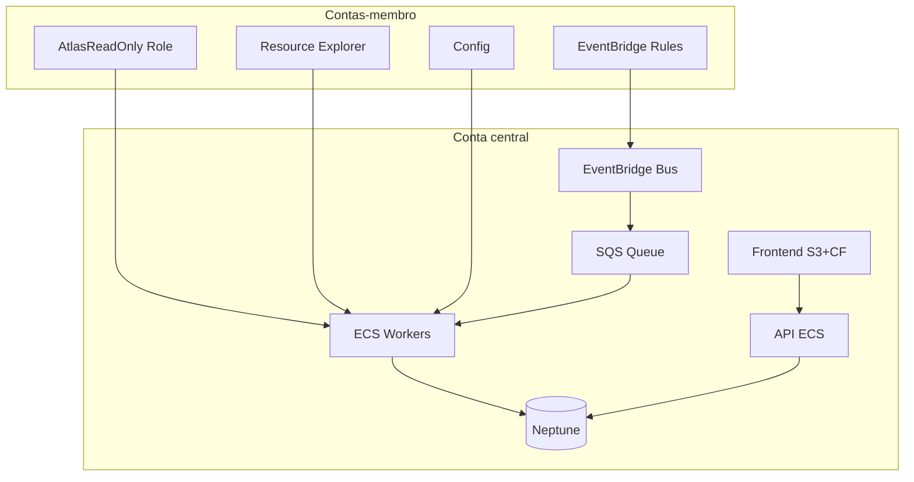

# Arquitetura AWS-Horus

## Componentes

### Inventário multi-conta
1. **AWS Resource Explorer** (preferencial quando multi-account habilitado): busca por metadados, deduplicado por ARN.
2. **AWS Config Aggregator** (organização): configuração completa quando disponível.
3. **APIs Describe/List/Get** diretas: para relações não cobertas (ex.: detalhes de ENI attachment, resource policies).

Descoberta de contas: `organizations:ListAccounts` (contínua).
Descoberta de regiões: `ec2:DescribeRegions` por conta + Resource Explorer.

### Modelo universal de conexão (aresta)
```json
{
  "source_arn": "...",
  "target_arn": "...",
  "direction": "out|in|bidirectional",
  "category": "REDE|EVENTO/INTEGRAÇÃO|IAM/AUTORIZAÇÃO|DNS|DADOS/REPLICAÇÃO|CRIPTOGRAFIA|OBSERVABILIDADE|DEPLOY/CI-CD",
  "mechanism": "security-group-rule|event-source-mapping|resource-policy|vpc-endpoint|eni-attachment|...",
  "ports": [443],
  "protocol": "tcp|udp|...",
  "evidence": {"rule_id": "...", "policy_sid": "..."},
  "evidence_level": "DECLARADA|PERMITIDA|OBSERVADA",
  "risk": "low|medium|high|none",
  "first_seen": "...",
  "last_seen": "..."
}
```

### Camadas de análise
- **Genérica**: referências de ARN/ID em config, ENI RequesterId/Description, SG, subnet, role, KMS, logs, tags.
- **Alcançabilidade (PERMITIDA)**: SG (incluindo SG→SG), NACL, rotas, TGW, peering, endpoints, cross-account.
- **Observada**: VPC Flow Logs, CloudTrail, X-Ray, access logs (quando habilitados).

### Atualização
- EventBridge (CloudTrail management + Config) de cada conta → bus central → SQS → workers incrementais.
- Full reconciliation a cada 6h (configurável).
- Lacunas de fontes registradas na matriz.

### Banco
Amazon Neptune (property graph, openCypher). Nós com ARN como ID único. Arestas conforme modelo acima. Snapshots para histórico/diff.

### Frontend
React + TypeScript + Cytoscape.js (ou ELK). Zoom semântico, painel lateral, filtros, "como A chega em B?", export PNG/SVG/JSON/Mermaid.

### Segurança
- Role AtlasReadOnly nas membros: SecurityAudit + ViewOnlyAccess + extras listados.
- Trust apenas da role da ferramenta + ExternalId.
- Nenhuma escrita. Dados criptografados. Auditoria de consultas.

## Diagrama de alto nível (Mermaid)


